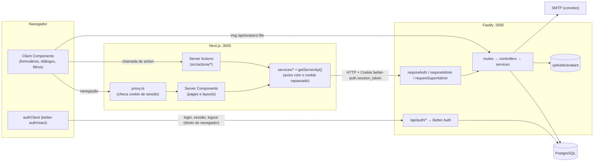

# Arquitetura

O **NetManager** (nome exibido) é um sistema web para gerenciar a rede e os ativos de TI: redes/sub-redes, IPs, departamentos, localidades e ativos (computadores, impressoras, telefones, câmeras, switches e Access Points). Tem também relatórios, auditoria e gestão de usuários por convite.

São **dois repositórios independentes**:

| Projeto | Pasta | Stack | Porta |
|---|---|---|---|
| Frontend | `gestao-de-ativos-front` | Next.js 16.4 (App Router, Turbopack), React 19.2, TypeScript, Tailwind v4, shadcn/ui, axios, better-auth (cliente), react-hook-form + zod | 3000 |
| Backend | `../sysip-backend-2.0` | Node 24, Fastify 5.7, fastify-type-provider-zod, Prisma 7.4 (adapter `pg`) + PostgreSQL, Better Auth 1.4, nodemailer, sharp/file-type | 3005 |

Não há tipos compartilhados por pacote. O contrato existe duas vezes: nos schemas zod do back (`back:src/validators/*`) e nos tipos escritos à mão no front (`src/types/*`).

## Diagrama

## Fluxo de dados entre front e back

1. **Login:** o navegador chama o Better Auth direto (`authClient.signIn.email`, em `src/app/login/page.tsx`), em `NEXT_PUBLIC_API_URL/api/auth/sign-in/email`. O back grava o cookie **assinado** `better-auth.session_token`.
2. **Navegação no painel:**
   - `src/proxy.ts` redireciona para `/login` quando o cookie não existe. É uma checagem otimista, só da presença do cookie.
   - O layout `src/app/(painel)/layout.tsx` (Server Component) busca `GET /api/users/me` para obter o perfil e o papel.
3. **Leitura de dados:**
   - Os Server Components chamam `src/services/*`, que usam `getServerApi()` (`src/lib/server-api.ts`).
   - Essa função cria um axios com `baseURL = NEXT_PUBLIC_API_URL` e **repassa o cookie** da requisição do usuário.
4. **Escrita de dados:**
   - Os Client Components chamam Server Actions (`src/actions/*`, com `"use server"`).
   - Elas validam com zod (`src/schemas/*`), chamam a API pelo mesmo `getServerApi()` e fazem `revalidatePath(...)`.
5. **No back:**
   - Cada rota declara `preHandler: [requireAuth, ...]` (`back:src/middlewares/auth.middlewares.ts`).
   - `requireAuth` resolve a sessão com `auth.api.getSession`.
   - `requireAdmin` e `requireSuperAdmin` leem o `role` no banco, porque a sessão do Better Auth não traz o papel.
6. **Resposta:** o padrão é `{ data, error }` (`src/types/api.ts`). As listagens trazem `meta: { total, page, limit, totalPages }`.

## Server × Client

- **Server Components:** quase todas as `page.tsx`. Buscam os dados e passam aos componentes de UI. Exemplos: listagens de ativos, `infra/*`, `users`, `settings/profile`.
- **Client Components:**
  - Formulários de criação (`assets/*/add/page.tsx` são páginas inteiras client).
  - `login/page.tsx`.
  - Diálogos, filtros, paginação, sidebar.
  - `PainelShell`.
- **Atenção:** o `src/components/painel-shell.tsx` é client e só mostra o conteúdo depois que `authClient.useSession()` responde. Ver M1 em [problemas-encontrados.md](./problemas-encontrados.md).
- **Server Actions:** usadas para mutações, mas também para leitura em alguns lugares (`get*Action`). Ver M14.

## Autenticação e autorização (resumo)

- **Better Auth com e-mail e senha:** sessão em cookie com o prefixo `better-auth`. O back exige o `Origin` em `trustedOrigins`.
- **Papéis (`UserRole`):** `SUPERADM`, `ADMIN`, `USER` e `CAM_OPERATOR`.
  - `SUPERADM` gerencia usuários.
  - `ADMIN` ou `SUPERADM` altera redes e vê a auditoria.
  - O resto exige só estar logado. Ver A2.
- **Entrada de usuários:** por convite. O SUPERADM convida, o convidado recebe o link `FRONTEND_URL/accept-invite?token=...` e cria a conta, com foto opcional.
- **Avatar:** cada usuário só altera a própria foto. O arquivo vai para `UPLOADS_DIR/avatars/<uuid>.webp`, e o banco guarda `/api/avatars/<arquivo>`.

Detalhes: [backend.md](./backend.md) e [dados-e-api.md](./dados-e-api.md).
